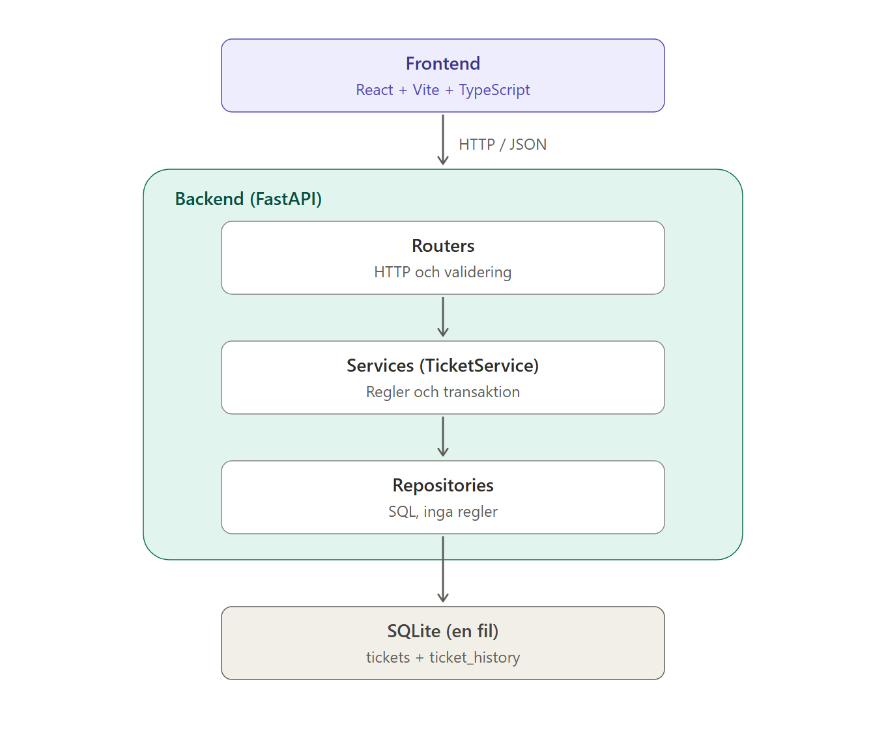
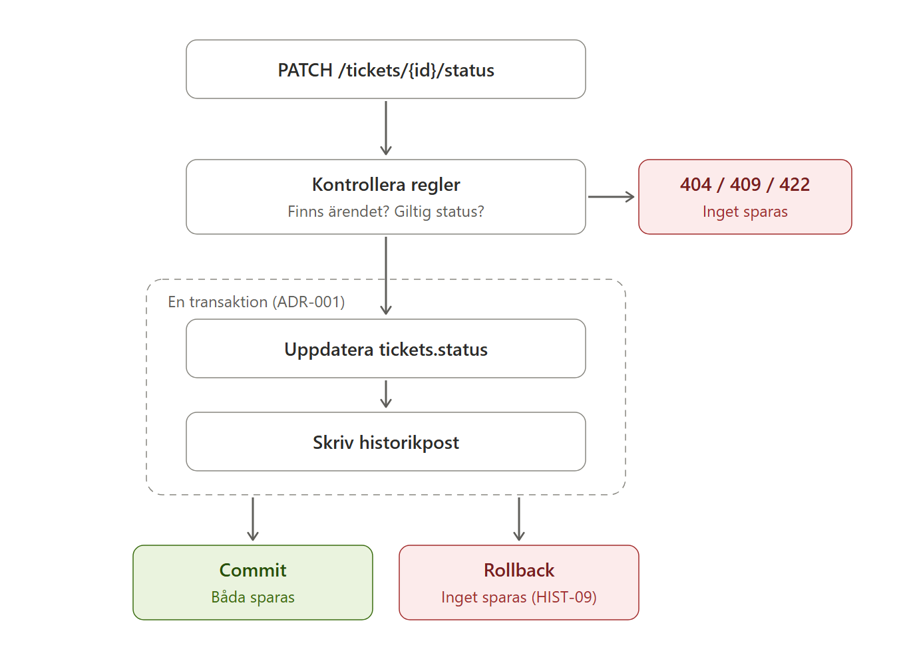

# Arkitektur och projektstruktur

> **Huvudversion** för stack, lagerregler och mappstruktur. Gäller all kod i projektet.
> Ändras bara här, via PR. Ansvarig: Azalea · Granskare: alla.
> Flyttad från Linear till repot 2026-10-25.

## 1. Stack (beslutad på teammötet 2026-10-25)

| Del | Teknik |
| --- | --- |
| Backend | Python 3.11, FastAPI, SQLAlchemy 2, port 8010 |
| Lagring | SQLite (en fil, `backend/data/app.db`) |
| Frontend | React, Vite, TypeScript, Tailwind CSS v4, shadcn/ui, pnpm |
| Tester | pytest (backend), vitest (frontend) |
| CI | GitHub Actions, `.github/workflows/tests.yml` |

Alternativet TypeScript rakt igenom valdes bort. Fördelen med det, delade typer, får vi
genom att frontend genererar TypeScript-typer från backendens OpenAPI-schema (se
[API-konventioner](api-konventioner.md), avsnitt 6). Jämförelsen och beslutet dokumenteras i
`docs/decisions/` (ADR-002, Nicklas).

## 2. Lager

```
React UI ──/api──> Vite-proxy ──HTTP/JSON──> FastAPI routers ──> Services ──> Repositories ──> SQLite
                                             (validering, HTTP)  (regler,     (SQL, inga        (fil)
                                                                  transaktion)  regler)
```

### Arkitektur i lager



### Flöde vid statusändring (se ADR-001)



## 3. Regler per lager

- **Routers** hanterar HTTP och validering av indata (Pydantic). Inga affärsregler.
- **Services** äger reglerna och **transaktionsgränsen**. En operation som skriver flera
  saker (t.ex. status + historikpost) gör det i *samma* transaktion. Status skrivs **bara**
  via `TicketService`.
- **Repositories** är tunna, använder parametriserade frågor via SQLAlchemy och känner inte
  till HTTP.
- **Databas-URL** kommer från konfiguration (`DATABASE_URL`), så att tester kan peka på en
  temporär fil.
- **Tid** kommer från en utbytbar klocka (en funktion som skickas in), så att tester kan
  styra tidpunkter.
- **API-kontraktet** är OpenAPI-schemat på `/openapi.json` (se
  [API-konventioner](api-konventioner.md)).

Hur atomiciteten mellan status och historik garanteras beslutas i ADR-001
(`docs/decisions/`), som jämför transaktion i tjänstelagret, databastrigger och event
sourcing.

## 4. Projektstruktur

```
AGENTS.md, CLAUDE.md          regler för AI-agenter (CLAUDE.md importerar AGENTS.md)
.github/workflows/            CI
backend/app/                  main.py, config.py, db.py, api/ (senare services/, repositories/, models/, schemas/)
backend/tests/                pytest
frontend/src/                 App.tsx, components/ui/ (shadcn), lib/
docs/specs/                   en spec per funktion (CORE, HIST)
docs/decisions/               tekniska beslut (ADR)
docs/status/                  veckostatus V5–V8
docs/                         ansvar, API-konventioner, arkitektur, teststrategi, verifiering
```

Körinstruktioner för hela stacken finns i `README.md` i repots rot.
