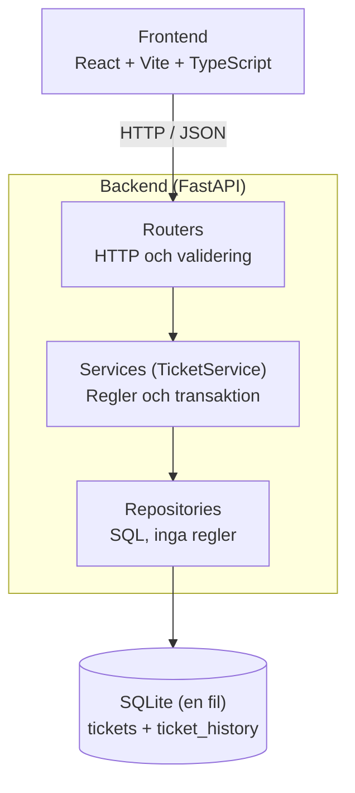

# Spec: Statuslogik och ärendehistorik (kompletterande funktion)

> Status: **v0.7, luckor från testförslagskörningarna fyllda** · Ansvarig: Azalea (Azaalea) · Vecka 5
> Detta dokument är teamets underlag. Individuell redovisning ligger inte här.
>
> **Ändrat i v0.3 (2026-10-23), efter feedback från teamet:** kärnan får en
> egen spec (CORE-id, Nicklas), stacken är ett öppet beslut till söndag den 25/10, alla fyra i
> teamet finns i ansvarstabellen, frontend ligger inte längre på Azalea, mutationsprövningen
> görs korsvis, och kraven speglas i Linear med krav-id.
>
> **Ändrat i v0.4 (2026-10-24):** Amalia äger tidslinjen (HIST-05) och UI-delen av HIST-14,
> Azalea backend-delen av HIST-14. Komponenttestet för tidslinjen är Amalias.
>
> **Ändrat i v0.5 (2026-10-24), efter CORE-specen v0.2:** HIST-08 ger 404 "Ärendet finns inte."
> även när id inte är ett heltal (samma som B8 i CORE). HIST-10 prövar bara att ingen
> historikpost sparas; att inget ärende sparas prövas i CORE.
>
> **Ändrat i v0.6 (2026-10-25), efter teammötet:** stacken och ansvarstabellen är beslutade.
> HIST-06 säger att fel datatyp ger "Ogiltig indata." (samma som B9 i CORE).
>
> **Ändrat i v0.7 (2026-10-25), efter körningarna av testinstruktion v1:** exakta meddelanden
> för ogiltig status (HIST-06) och samma status (HIST-07), svaret när historiken inte kan
> sparas (HIST-09, 503), vad omstart betyder i testet (HIST-04), vem som äger testerna för
> HIST-07, ADR-001 i `docs/decisions/`. Statusbytet hör till milstolpe 03, eftersom
> examinationen räknar "ändra status" till kärnan. Historiken är tilläggsfunktionen (04).

**Gemensamma dokument (huvudversioner) i repot.** Delar av specen gäller hela teamet och
har därför fått egna dokument. Specen är fortfarande komplett, men vid skillnad gäller det
gemensamma dokumentet, och ändringar görs där först.

| Dokument | Huvudversion för | Avsnitt här |
| --- | --- | --- |
| [API-konventioner](../api-konventioner.md) | Statuskoder, felformat, tider, språk, endpoints, OpenAPI-kontraktet | 3, 5 |
| [Ansvar och granskning](../ansvar-och-granskning.md) | Vem äger och granskar vad | 2 |
| [Arkitektur och projektstruktur](../arkitektur.md) | Stack, lager, regler per lager, mappar | 3, 7, 9 |
| [Teststrategi och verifiering](../teststrategi.md) | Testnivåer, mutationsprövning, testinstruktion | 10 |

## 1. Objective

Handläggare ska kunna **ändra status på ett ärende** och se **vad som hänt med ärendet och
när**. Varje gång ett ärende skapas eller byter status sparas en oföränderlig historikpost.
Historiken visas som en tidslinje i ärendets detaljvy.

**Kärna och tilläggsfunktion.** Statusbytet (`PATCH /tickets/{id}/status` och statusreglerna,
HIST-06, 07, 08, 13) hör till kärnan, eftersom uppgiften kräver "ändra status på ett ärende"
(milstolpe 03). **Den kompletterande funktionen är ärendehistoriken** (HIST-01–05, 09–12, 14,
milstolpe 04). Båda ligger i samma spec eftersom historiken skrivs i samma transaktion som
statusbytet.

**Varför just historik?** Funktionen berör alla lager (databas, tjänstelogik, API, UI) och
har en verklig teknisk risk: statusändringen och historikposten måste lyckas eller
misslyckas *tillsammans*. Den gör också lagringskravet ("finns kvar efter omstart")
mätbart.

**Användare:** handläggare (en roll, ingen inloggning).

**Framgång:** en handläggare kan följa ett ärendes väg från *Nytt* till *Avslutat* i rätt
ordning, och historiken är aldrig i otakt med ärendets faktiska status.

## 2. Avgränsning

| Ingår                                                  | Ingår inte                                                                  |
| ------------------------------------------------------- | ---------------------------------------------------------------------------- |
| Statusregler och `PATCH /tickets/{id}/status`         | Redigering/radering av historikposter                                        |
| Historikpost vid skapande och vid statusändring        | Vem som gjorde ändringen (ingen autentisering i uppgiften)                  |
| `GET /tickets/{id}/history` och tidslinje i detaljvyn | Historik för ändring av rubrik, beskrivning m.m. (kan läggas till senare) |
| Atomisk koppling mellan status och historik             | Notifieringar, export, filtrering av historik                                |

**Beroende på teamets kärna**, som specas i en egen spec med **CORE-id**
(`docs/specs/SPEC-karna.md`, första utkast av Nicklas): ärendemodell (rubrik,
beskrivning, kategori, prioritet, status, skapad), `POST /tickets`, `GET /tickets`,
`GET /tickets/{id}`, validering av obligatoriska fält. Min del äger statusvärdena,
statusreglerna och `PATCH`, utökar `POST` så att den skriver historik, och lägger till
`GET /tickets/{id}/history`.

**Gränssnitt mellan CORE och HIST** (så att specarna inte motsäger varandra):

- CORE använder statuskoderna i antagande 2 och felformatet i avsnitt 5
  (`{"detail": "<svenskt meddelande>"}`, även för 422). Ingen av specarna definierar egna.
- Ett nytt ärende får status `new` (CORE) och en `created`-post (HIST-01) i samma
  transaktion. Misslyckad validering skapar varken ärende eller post (ärendet prövas i CORE, historikposten i HIST-10).
- Status ändras bara via `PATCH /tickets/{id}/status` (HIST). CORE:s endpoints ändrar
  aldrig status.

**Ansvar** (bekräftat av alla fyra på teammötet 2026-10-25)

| Del                                                                                                                                         | Ansvarig                       | Granskare       | Läge                                            |
| ------------------------------------------------------------------------------------------------------------------------------------------- | ------------------------------ | --------------- | ------------------------------------------------ |
| **Backend som helhet:** skelett, SQLite, kärnans API (CORE) och `/health`                                                          | Azalea                         | Nicklas         | Bekräftat 2026-10-25 |
| Statusregler, historik, transaktionsgräns, ADR-001                                                                                         | Azalea                         | Nicklas         | Bekräftat 2026-10-25 |
| API-kontrakt som OpenAPI (`/openapi.json`), klart innan frontend bygger mot det                                                           | Azalea                         | Mustafa         | Bekräftat 2026-10-25 |
| Tester för historik, atomicitet och persistens: **HIST-01, 02, 03, 04, 08, 09, 10, 11, 12** och invarianttestet                      | Azalea                         | Nicklas         | Bekräftat 2026-10-25 |
| Spec för kärnan (**CORE-01, 02 …**) i samma stil som denna                                                                         | Nicklas                        | Azalea          | Bekräftat 2026-10-25 |
| Tester för statusregler: **HIST-06, 07, 13**                                                                                         | Nicklas                        | Azalea          | Bekräftat 2026-10-25 |
| Tester för kärnans validering (CORE-kriterierna)                                                                                          | Nicklas                        | Azalea          | Bekräftat 2026-10-25 |
| Teamets verifieringsplan (`docs/verifiering.md`), HIST-raderna skrivs av Azalea                                                           | Nicklas                        | Azalea          | Bekräftat 2026-10-25 |
| Teknikbeslut om stacken (jämförelse och beslut, se antagande 1)                                                                           | Nicklas                        | Alla            | Bekräftat 2026-10-25 |
| Mutationsprövning, **korsvis** (avsnitt 10): var och en prövar sina egna tester                                                     | Azalea, Nicklas                | den andra       | Bekräftat 2026-10-25 |
| Instruktion för testförslag: v1                                                                                                           | Nicklas                        | Azalea          | Bekräftat 2026-10-25 |
| Förbättring av instruktionen: **var och en gör en egen, namngiven förbättring**, prövad på egna kriterier och jämförd med v1 | Azalea, Nicklas (var för sig) | den andra       | Bekräftat 2026-10-25 |
| Frontend: lista, detaljvy, formulär för att skapa ärenden, statusbyte, vitest                                                            | Mustafa                        | Azalea          | Bekräftat 2026-10-25 |
| Tidslinje (HIST-05) och **UI-delen av HIST-14** (felmeddelanden i UI), med komponenttest för tidslinjen | Amalia | Mustafa, Azalea | Bekräftat 2026-10-25 |
| **Backend-delen av HIST-14:** alla fel som `{"detail": "<svenska>"}` utan stacktrace eller databasdetaljer | Azalea | Nicklas | Bekräftat 2026-10-25 |
| Linear: milstolpar, ärenden och mallar (Nicklas lägger till fält för krav-id och "faller av rätt anledning")                           | Mustafa                        | Nicklas         | Bekräftat 2026-10-25 |

Azalea bygger inte frontend. Hon granskar frontend-PR:er som rör API-kontraktet.

## 3. Antaganden (rätta mig nu)

1. Webbapp som körs lokalt. **Stacken beslutades på teammötet 2026-10-25:** backend
   **Python 3.11 + FastAPI + SQLAlchemy 2.x + SQLite** (port 8010), frontend **React + Vite +
   TypeScript + Tailwind CSS v4 + shadcn/ui** med pnpm. Frontend genererar TypeScript-typer från
   FastAPI:s OpenAPI-schema (`openapi-typescript` mot `/openapi.json`), så att frontend och
   backend delar samma kontrakt. Alternativet TypeScript rakt igenom valdes bort. Nicklas
   dokumenterar jämförelsen och beslutet i `docs/decisions/`.
2. Statusar lagras och skickas som **stabila koder**, och UI visar svenska etiketter:

   | Kod (API/DB)            | Etikett (UI)     |
   | ----------------------- | ---------------- |
   | `new`                 | Nytt             |
   | `in_progress`         | Pågående       |
   | `waiting_on_customer` | Väntar på kund |
   | `closed`              | Avslutat         |

   Alla övergångar mellan *olika* statusar är tillåtna, inklusive att öppna ett avslutat
   ärende igen. Nya ärenden får alltid `new`.
3. Tider lagras som UTC i ett fast format (`YYYY-MM-DDTHH:MM:SS.ffffffZ`, alltid
   mikrosekunder) så att textsortering blir korrekt, och visas i lokal tid i UI.
4. Allt språk mot användaren är svenska. API-fältnamn och statuskoder är engelska.
5. Endast påhittade kunduppgifter.

## 4. Datamodell

```
ticket_history
  id           INTEGER  PK, autoincrement
  ticket_id    INTEGER  FK -> tickets.id, NOT NULL, indexerad
  event_type   TEXT     'created' | 'status_changed'  NOT NULL
  from_status  TEXT     NULL för 'created'
  to_status    TEXT     NOT NULL
  occurred_at  TEXT     UTC, fast format enligt antagande 3, NOT NULL
```

Regler: `to_status` måste vara en giltig statuskod. `from_status` är `NULL` om och endast
om `event_type = 'created'`. Poster ändras eller tas aldrig bort av applikationen.

## 5. API-kontrakt (min del)

| Metod och väg                 | Lyckat svar                                                     | Fel                                                                        |
| ------------------------------ | --------------------------------------------------------------- | -------------------------------------------------------------------------- |
| `POST /tickets` (utökas)    | 201, ärendet. Skapar en `created`-post.                      | 422 vid ogiltig indata, då skapas varken ärende eller post               |
| `PATCH /tickets/{id}/status` | 200, ärendet med ny status. Skapar en `status_changed`-post. | 404 okänt ärende (även id som inte är heltal) · 422 ogiltig status · 409 samma status som nuvarande · 503 om historikposten inte kan sparas (inget ändras) |
| `GET /tickets/{id}/history`  | 200, lista äldst först                                        | 404 okänt ärende (även id som inte är heltal)                            |

**Anrop och svar**

```jsonc
// PATCH /tickets/{id}/status
{ "status": "in_progress" }

// GET /tickets/{id}/history -> 200
[
  { "id": 1, "event_type": "created",        "from_status": null,  "to_status": "new",         "occurred_at": "2026-10-22T09:00:00.000000Z" },
  { "id": 2, "event_type": "status_changed", "from_status": "new", "to_status": "in_progress", "occurred_at": "2026-10-22T09:05:12.123456Z" }
]
```

**Felformat.** Alla fel har formen `{"detail": "<begripligt svenskt meddelande>"}`, även
valideringsfel. FastAPI:s standardsvar för 422 är en lista på engelska, så backend
registrerar en egen hanterare för `RequestValidationError` som översätter till formatet
ovan (krävs för HIST-06 och HIST-14).

**Felmeddelanden för statusändring och historik** (huvudversion i
[API-konventioner](../api-konventioner.md), avsnitt 2):

| Situation | HTTP | Meddelande |
| --- | --- | --- |
| Okänt ärende, eller id som inte är ett heltal | 404 | Ärendet finns inte. |
| Okänd eller saknad status (t.ex. `"klar"`) | 422 | Välj en giltig status. |
| Fel datatyp (t.ex. `{"status": 5}`), saknad kropp eller trasig JSON | 422 | Ogiltig indata. |
| Samma status som nuvarande | 409 | Ärendet har redan den statusen. |
| Historikposten kunde inte sparas (allt rullas tillbaka) | 503 | Statusen kunde inte ändras. Försök igen. |

## 6. Acceptanskriterier

Varje kriterium har ett id som används i tester, commits och PR-beskrivningar.
HIST-06, 07 och 13 är statusregler, de övriga gäller historiken.

**Happy paths**

- **HIST-01** Givet att ett giltigt ärende skapas, när anropet lyckas, då har ärendet
  status `new` och det finns exakt en historikpost med `event_type='created'`,
  `from_status=NULL` och `to_status='new'`.
- **HIST-02** Givet ett ärende med status `new`, när status ändras till `in_progress`, då
  har ärendet status `in_progress` och en post `status_changed` med `from='new'`,
  `to='in_progress'`.
- **HIST-03** Givet flera statusändringar, när historiken hämtas, då kommer posterna
  äldst först och `to_status` i en post är lika med `from_status` i nästa.
- **HIST-04** Givet ett ärende med historik, när applikationen startas om, då är både
  status och historik oförändrade. "Omstart" betyder i testet en **ny engine och ny
  session mot samma databasfil**, inte samma session (annars syns osparade ändringar).
  Den gamla engine stängs först (`dispose()`, annars kan SQLite-filen vara låst på Windows),
  och kontrollen görs via API:t med en ny app-instans som läser databas-URL:en från
  konfigurationen. "Oförändrade" betyder alla fält, även `id` och `occurred_at`.
- **HIST-05** Givet ett ärende, när historiken visas i detaljvyn, då visas varje post med
  statusövergång (svenska etiketter) och tidpunkt i lokal tid, och senaste posten
  stämmer med ärendets aktuella status.

**Error paths**

- **HIST-06** Givet en ogiltig status (`"klar"`), när statusändring försöks, då svarar
  API:t 422 med "Välj en giltig status.", ärendets status är oförändrad och
  ingen ny historikpost har skapats.
  Fel datatyp (t.ex. `{"status": 5}`) ger i stället bara "Ogiltig indata." (samma som B9 i CORE).
- **HIST-07** Givet att ärendet redan har status `in_progress`, när samma status skickas,
  då svarar API:t 409 med "Ärendet har redan den statusen." och ingen historikpost skapas.
  Det gäller alla fyra statusar, även ett nytt ärende som får `new` igen.
- **HIST-08** Givet ett okänt ärende-id, när historik hämtas eller status ändras, då
  svarar API:t 404 med "Ärendet finns inte." och inget skapas. Samma gäller ett id som
  inte är ett heltal, t.ex. `GET /tickets/abc/history` och `PATCH /tickets/abc/status`
  (samma beslut som B8 i CORE-specen).
- **HIST-09** Givet att skrivningen av historikposten misslyckas, när status ändras, då
  rullas statusändringen tillbaka och ärendet behåller sin gamla status (atomicitet).
  API:t svarar 503 med "Statusen kunde inte ändras. Försök igen." utan tekniska detaljer
  (samma statuskod som `/health` när databasen inte går att nå, se ADR-001).
  Statusen är oförändrad även när databasfilen läses med en ny engine, och nästa
  statusändring på samma ärende lyckas (sessionen lämnas inte trasig).
- **HIST-10** Givet att ärendet inte kan skapas (t.ex. tom rubrik), när `POST` körs, då
  finns ingen historikpost kvar. (Att inget *ärende* sparas prövas i CORE-06–09, 11–13,
  17 och 18. HIST-10 prövar bara historiken, så samma fall testas inte två gånger.)

**Gränsfall**

- **HIST-11** Givet två statusändringar med samma `occurred_at`, när historiken hämtas,
  då är ordningen ändå deterministisk (sortering på `occurred_at`, sedan `id`). Testas
  med en fast klocka (se avsnitt 7).
- **HIST-12** Givet ett ärende utan statusändringar, när historiken hämtas, då returneras
  en lista med exakt en post (`created`), inte en tom lista.
- **HIST-13** Givet ett avslutat ärende, när det öppnas igen (`closed` → `new`), då
  accepteras det och loggas som vanlig statusändring.

**Icke-funktionella**

- **HIST-14** Felmeddelanden är på svenska och innehåller aldrig stacktrace eller
  databasdetaljer. (Automatiskt: format och språk. Manuellt: begriplighet.)
  Backend-delen (felformatet) ägs av Azalea, UI-delen (hur felen visas) av Amalia.

**Invariant (kontrolleras efter varje integrationsscenario, se ADR-001):** historikens
senaste `to_status` är lika med ärendets `status`.

## 7. Teknisk arkitektur

```
React UI ──HTTP/JSON──> FastAPI routers  ──> Services ──> Repositories ──> SQLite
                        (validering, HTTP)   (regler,      (SQL, inga        (fil)
                                              transaktion)   regler)
```



- **Routers** hanterar HTTP och Pydantic-validering, inga affärsregler.
- **Services** äger reglerna och **transaktionsgränsen**: `change_status()` ändrar
  status och skriver historik i *samma* transaktion (HIST-09). Status skrivs **bara**
  via `TicketService`.
- **Repositories** är tunna och känner inte till HTTP.
- Databas-URL kommer från konfiguration, så tester kan peka på en temporär fil.
- **API-kontraktet är OpenAPI-schemat** som FastAPI genererar (`/openapi.json`). Frontend
  genererar sina TypeScript-typer därifrån i stället för att skriva dem för hand, så att
  en ändring i backend syns som typfel i frontend. Kontraktet för CORE och HIST ska finnas
  innan frontend bygger mot det, så att Mustafa och Amalia inte väntar på implementationen.
- Tjänsten får tiden från en **utbytbar klocka** (en funktion som skickas in), så att
  tester kan styra `occurred_at` (HIST-11).

Hur atomiciteten garanteras beslutas i
[ADR-001](../decisions/ADR-001-atomicitet-status-och-historik.md), som jämför
(a) transaktion i tjänstelagret, (b) databastrigger och (c) event sourcing.

## 8. Commands

Börja i **repots rotmapp**. Kommandona anropar Python i `.venv` direkt, så ingen
aktivering behövs (det undviker också PowerShells körpolicy).

**Backend, Windows (PowerShell)**

```powershell
cd backend
py -3.11 -m venv .venv
.\.venv\Scripts\python -m pip install -r requirements.txt
.\.venv\Scripts\python -m pytest -q                        # alla tester
.\.venv\Scripts\python -m pytest -q -k history             # endast historiktester
.\.venv\Scripts\python -m uvicorn app.main:app --reload --reload-dir app --port 8010   # http://localhost:8010/docs
```

**Backend, macOS/Linux**

```bash
cd backend
python3.11 -m venv .venv
.venv/bin/python -m pip install -r requirements.txt
.venv/bin/python -m pytest -q
.venv/bin/python -m uvicorn app.main:app --reload --reload-dir app --port 8010
```

`--reload-dir app` gör att servern bara startar om när vår egen kod ändras. Utan den
bevakas hela `backend/`, även `.venv`, och servern kan starta om mitt i ett anrop när
till exempel OneDrive synkar filer där.

**Frontend** (från repots rotmapp, pnpm enligt stackbeslutet)

```bash
cd frontend
pnpm install
pnpm dev                        # http://localhost:5173, /api går till backend på 8010
pnpm test                       # vitest (när testerna finns)
```

**Port 8010.** Projektet körs på 8010, inte uvicorns standard 8000, eftersom 8000 ofta används av andra lokala appar. Kontrollera att `/health` svarar `{"status": "ok", "database": "ok"}`, inte bara 200: svarar något annat är det ett annat program på porten.

## 9. Projektstruktur (förslag)

```
backend/app/{main.py, api/, services/, repositories/, models/, schemas/, config.py}
backend/tests/{unit/, integration/}
frontend/src/{components/, pages/, api/}
docs/{specs/, decisions/, status/, verifiering.md}
```

## 10. Testningsstrategi

| Nivå                                 | Vad                                                         | Verktyg                              | Täcker                                                        | Ansvarig             |
| ------------------------------------- | ----------------------------------------------------------- | ------------------------------------ | -------------------------------------------------------------- | -------------------- |
| Enhet och integration                 | Statusregler (samma status, giltiga värden, återöppning). Integrationstestet visar statuskoden och att ingen post finns i databasen | pytest, TestClient, temporär fil | HIST-06, 07, 13                                                | Nicklas              |
| Integration (API + riktig SQLite-fil) | Hela kedjan router → service → databas                    | pytest + TestClient, temporär fil   | HIST-01–03, 08, 10–12                                        | Azalea               |
| Integration, omstart                  | Ny engine mot samma fil                                     | pytest, temporär fil                | HIST-04                                                        | Azalea               |
| Integration, fel injicerat            | Tvinga historikinsättning att kasta fel                    | pytest + monkeypatch                 | HIST-09                                                        | Azalea               |
| Komponent                             | Tidslinjen renderar poster i ordning                        | vitest + Testing Library             | HIST-05                                                        | Amalia |
| Mutation                              | Testerna faller av rätt anledning (tabellen nedan)         | pytest, tillfälliga kodändringar   | HIST-01–04, 09 (Azalea) · HIST-06, 07, 13 och CORE (Nicklas) | Azalea, Nicklas      |
| Manuell                               | Meddelandens begriplighet, helhetsflöde                    | Checklista i `docs/verifiering.md` | HIST-14                                                        | Nicklas              |

**Varför integrationsnivå för kärnan:** kraven handlar om samspelet mellan API, regler och
lagring. Enhetstester med mockad databas kan inte visa HIST-04 eller HIST-09. Test genom
hela gränssnittet (webbläsare) skulle också täcka dem, men kräver mer verktyg och ger
långsammare och skörare tester utan att visa mer om atomicitet. Avvägningen prövas och
dokumenteras.

**Kontroll av testerna (mutation):** testerna ska falla av rätt anledning när koden görs
fel med flit. Minst dessa tre prövas:

| Mutation                                    | Ska fångas av  |
| ------------------------------------------- | --------------- |
| Historikinsättningen tas bort              | HIST-01, 02, 03 |
| `commit` sker före historikinsättningen | HIST-09         |
| `commit` tas bort (bara `flush`)        | HIST-04         |

Fler mutationer får läggas till för samma krav, t.ex. att statusen sparas i en egen
transaktion eller att felhanteringen sätter tillbaka en hårdkodad status (HIST-09).

**Korsvis prövning.** Var och en prövar sina egna tester med mutationerna ovan (Azalea)
respektive mutationer för statusreglerna och valideringen (Nicklas, t.ex. att 409-kontrollen
tas bort eller att tom rubrik accepteras). Därefter lägger **den andra** in en mutation som
testförfattaren inte känner till i förväg, och testförfattaren visar vilket test som faller
och varför. Ett test som är grönt trots mutationen förbättras av den som skrev det, och
före/efter sparas. Resultatet förs in i Verification-ärendet i Linear och i
`docs/verifiering.md`.

## 11. Boundaries

- **Alltid:** köra tester före commit, referera acceptanskriterie-id i commit och PR,
  validera indata i routern, använda parametriserade frågor via SQLAlchemy, skriva
  status enbart via `TicketService`.
- **Fråga först:** ändra tabellen `tickets` (teamets), lägga till beroenden, ändra
  API-kontrakt som frontend redan använder.
- **Aldrig:** committa hemligheter eller riktiga kunduppgifter, ta bort ett fallerande
  test utan godkännande, ändra historikposter från applikationskod.

**Spårbarhet:** HIST- och CORE-id står i varje commit, PR och Linear-ärende (fältet för
krav-id i mallarna). Kursansvariga granskar GitHub, så planering i Linear speglas alltid
med länkar i PR-beskrivningen. Ett krav kan följas så här: spec-id → Linear-ärende → PR →
test → körresultat i `docs/verifiering.md`.

**Koppling till milstolparna i Linear:**

| Milstolpe                      | Innehåll från denna spec och CORE                              |
| ------------------------------ | ---------------------------------------------------------------- |
| 01 · Planning & Architecture  | Denna spec, CORE-specen, teknikbeslutet om stacken, ADR-001      |
| 02 · Foundation & Database    | Skelett, SQLite, `/health`, körinstruktioner                  |
| 03 · Case Management          | CORE-kriterierna (skapa, lista, visa, validera) och statusbytet: `PATCH /tickets/{id}/status` med statusreglerna (HIST-06, 07, 08, 13). Examinationen räknar "ändra status" till kärnan. |
| 04 · Additional Feature       | Historiken: HIST-01–05, 09–12 och 14 (och ev. sök och filtrering) |
| 05 · Testing & Verification   | Testerna per krav-id, mutationsprövningen, verifieringsplanen   |
| 06 · Documentation & Delivery | Instruktion för testförslag, AI-arbetssätt, veckostatus, demo |

## 12. Öppna frågor

1. ~~**Stack**~~ Beslutad 2026-10-25, se antagande 1.
2. Statuskoder i API/DB och svenska etiketter i UI (antagande 2): ok för teamet innan
   frontend börjar använda värdena?
3. Ska `closed` kunna öppnas igen? (Jag antar ja, HIST-13.)
4. ~~Azalea tar backend som helhet~~ Bekräftat 2026-10-25.
5. ~~Mustafa: frontend~~ Bekräftat 2026-10-25.
6. ~~Amalia: vilken egen del?~~ Amalia har valt tidslinjen (HIST-05) och UI-delen av
   HIST-14, se PR #7 (Amalia tar tidslinje och felmeddelanden i UI, HIST-05 och HIST-14): https://github.com/desiboli/kundportal-ai-native-development/pull/7. Bekräftat 2026-10-25.
7. Instruktionen för testförslag: Nicklas skriver v1, och var och en gör sedan en egen,
   namngiven förbättring som prövas på egna kriterier. Ok?
8. Mutationsprövning korsvis enligt avsnitt 10. Ok?
9. Linear: ett ärende per task med krav-id, och datum på milstolparna (förslag: 01–02 v5,
   03 v6, 04–05 v7, 06 v8). Ok?
10. ~~Mötestid~~ Mötet hölls 2026-10-25.

## 13. Utökningar (parkerade)

`event_type` är en öppen uppsättning, så senare funktioner (interna anteckningar,
tilldelning) kan lägga till egna typer utan att ändra befintliga. Varje utökning får egen
spec med acceptanskriterier innan implementation.
